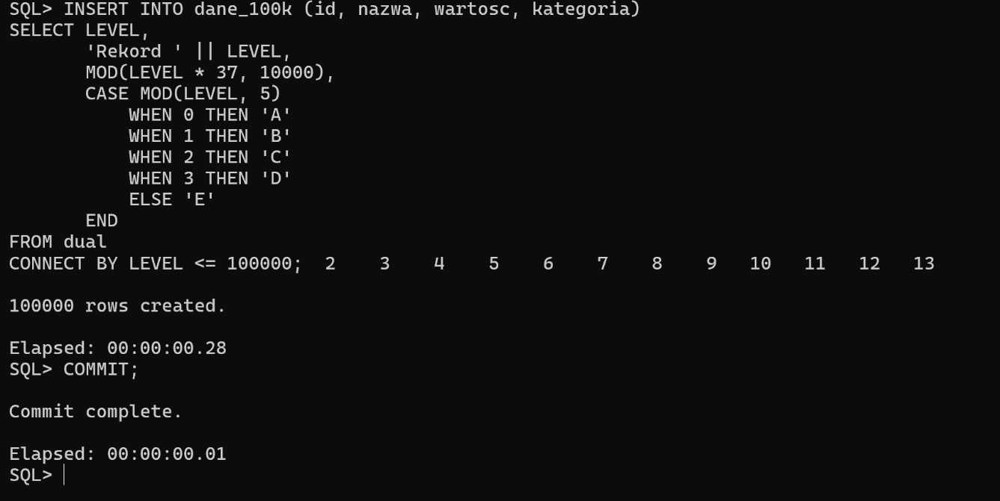
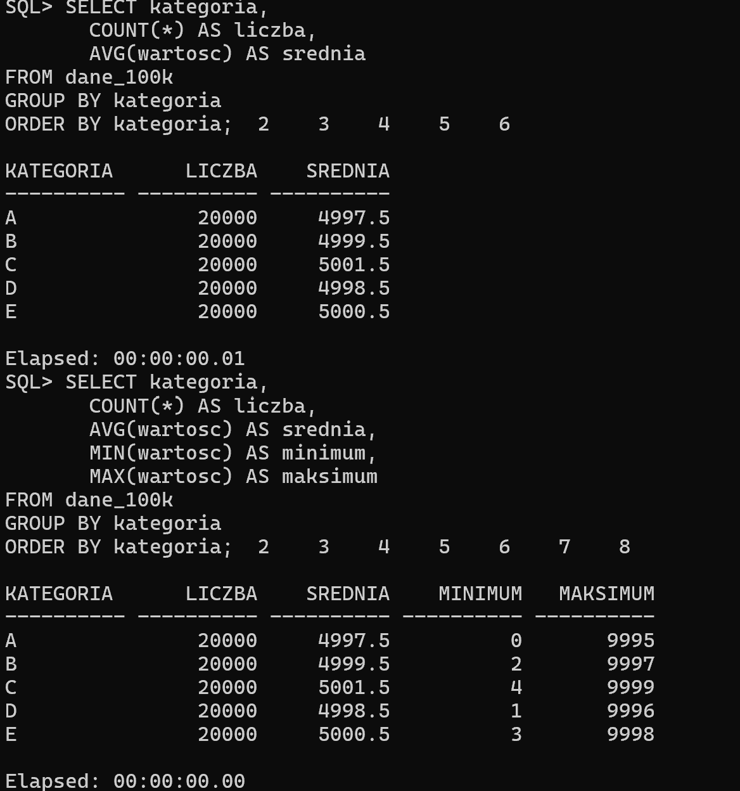
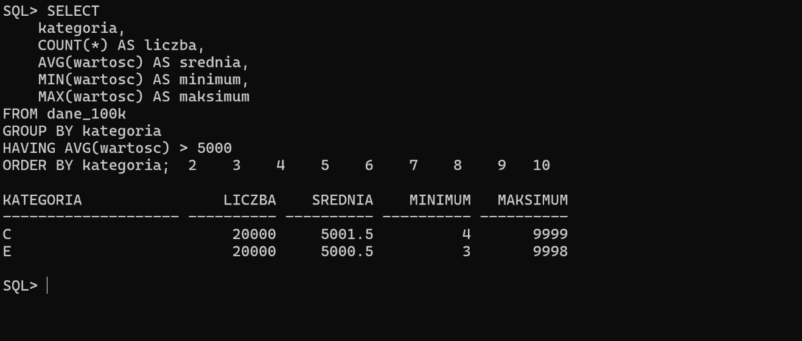
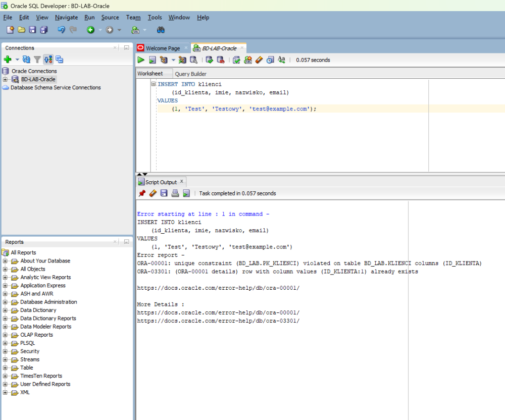
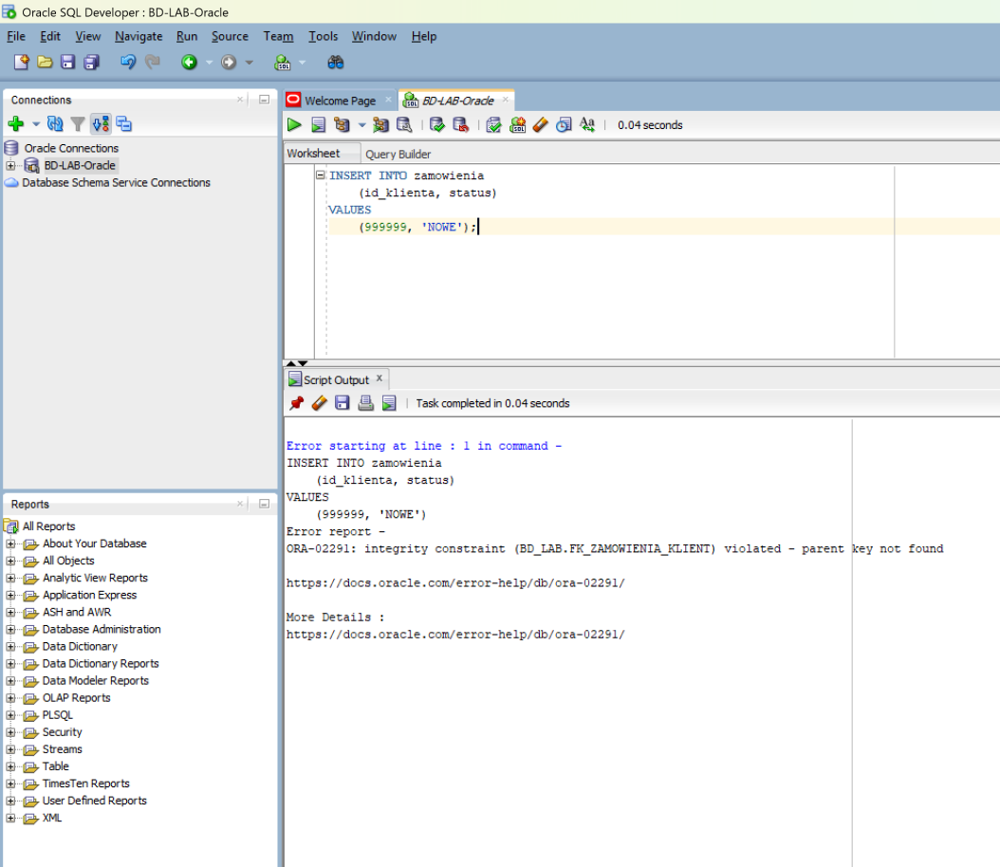
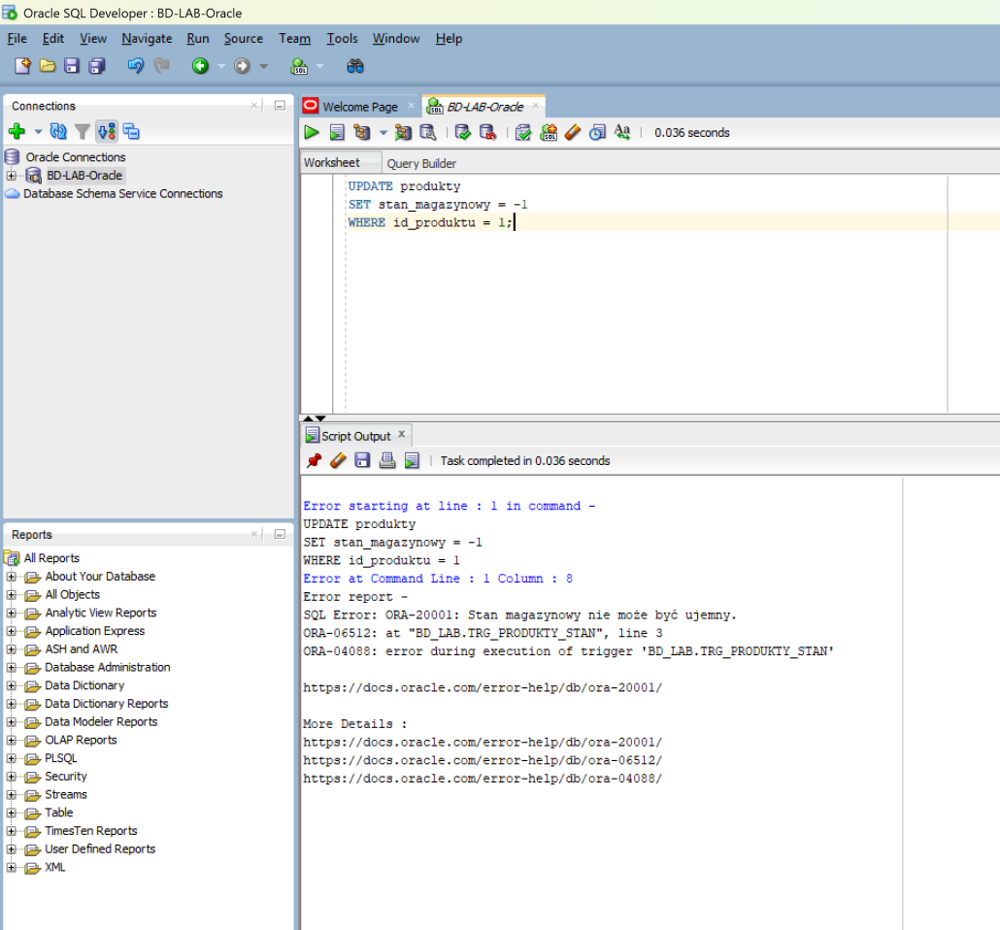
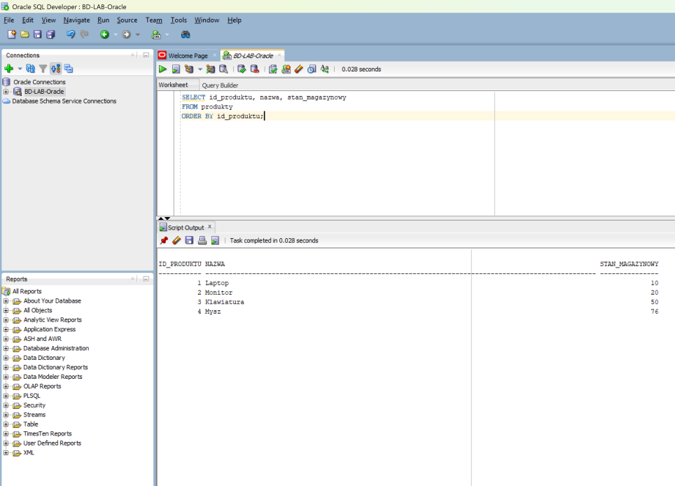
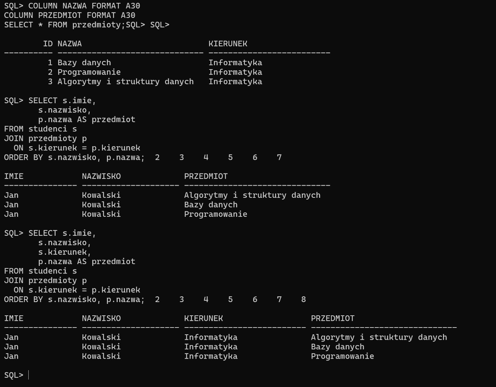

# 01 · Oracle: SQL, 100k rows and order integrity

Relational model of the order problem in **Oracle AI Database 26ai Free** running in Docker,
queried from SQL*Plus, SQL Developer and Python (python-oracledb + pandas).

## Scripts

| File | Content |
|---|---|
| `sql/01_basics.sql` | `WHERE`, `ORDER BY`, `GROUP BY`, `HAVING`, `JOIN` on the course dataset |
| `sql/02_dataset_100k.sql` | 100,000 rows generated with `CONNECT BY LEVEL`, filtering, top-N, aggregates, `HAVING AVG(...)` |
| `sql/03_orders_schema.sql` | `klienci`, `produkty`, `zamowienia`, `pozycje_zamowien` with PK/FK/UNIQUE/NOT NULL/CHECK, IDENTITY, `DEFAULT SYSDATE`; 4-table JOIN |
| `sql/04_integrity_triggers_transactions.sql` | failing inserts that prove integrity, `BEFORE`/`AFTER` triggers, `COMMIT`/`ROLLBACK` |
| `python/oracle_to_pandas.py` | aggregation done in Oracle, result read into a DataFrame |

## Results

- 100,000 rows inserted in **0.28 s**; `COUNT`, `AVG`, `GROUP BY` in about **0.01 s**.
- Every invalid operation was rejected by the database, with the name of the broken constraint:
  `ORA-00001` (PK and UNIQUE e-mail), `ORA-01400` (NOT NULL), `ORA-02290` (CHECK price > 0),
  `ORA-02291` (order for a non-existent customer).
- The `AFTER INSERT` trigger lowered the stock automatically (Mysz 80 → 76, Monitor 20 → 18).
  Lines added *before* the trigger existed were not affected: triggers don't work retroactively.
- `ROLLBACK` restored the Laptop stock 9 → 10; after `COMMIT` the change was permanent.
- IDENTITY values are unique but not consecutive: a new customer got id 23, because failed
  inserts also consume sequence values.

### Screenshots

100,000 rows generated in one statement (0.28 s):



Aggregation per category and the final task (`HAVING AVG(wartosc) > 5000` → C, E):




The database rejects invalid data: duplicate primary key and an order for a non-existent customer:




Triggers: the `BEFORE` trigger blocks a negative stock, the `AFTER` trigger lowers stock automatically (Mysz 80 → 76):




JOIN of students and courses:



**Takeaway:** the database guards only the rules that are defined in it, but it applies them
every time, even if the application has a bug.

## Run

```powershell
docker run -d --name bd-lab-oracle -p 1521:1521 `
  -e ORACLE_PWD=$env:ORACLE_PWD `
  -v bd-lab-oracle-data:/opt/oracle/oradata `
  container-registry.oracle.com/database/free:latest
```

In the course, the image and a pre-built data volume (user `bd_lab`, tables `studenci`, `przedmioty`)
were supplied by the instructor. With a clean image, create a user and the two tables first;
`02`–`04` only need a user with `CREATE TABLE`, `CREATE SEQUENCE` and `CREATE TRIGGER`.
