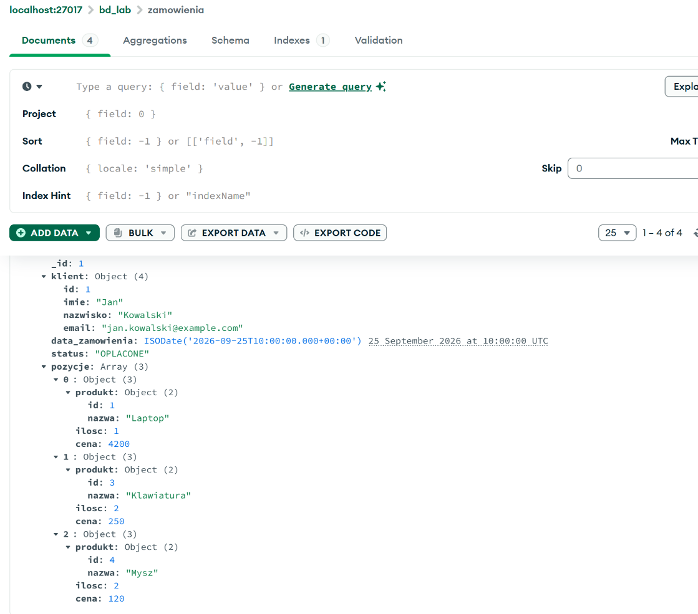
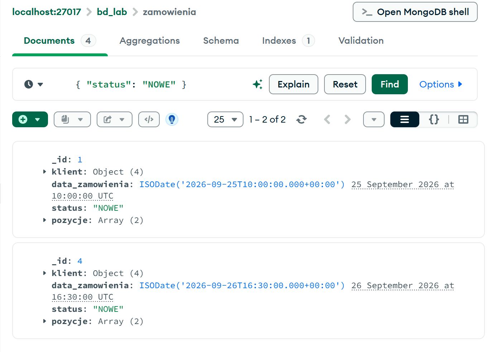
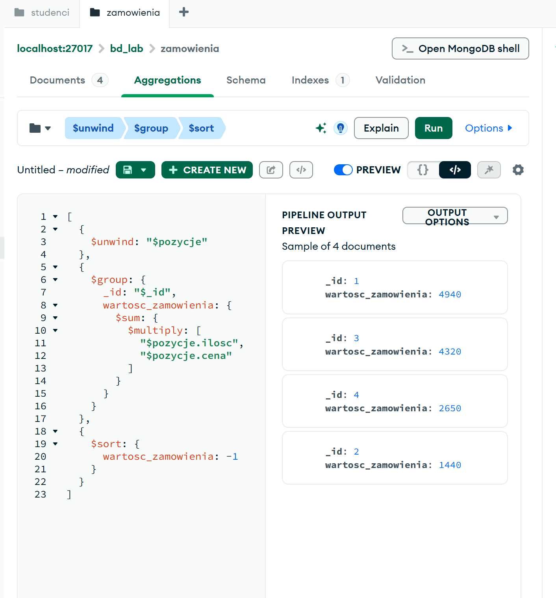
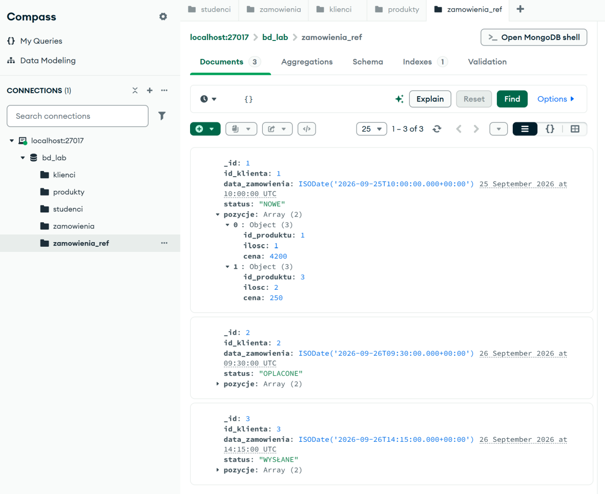
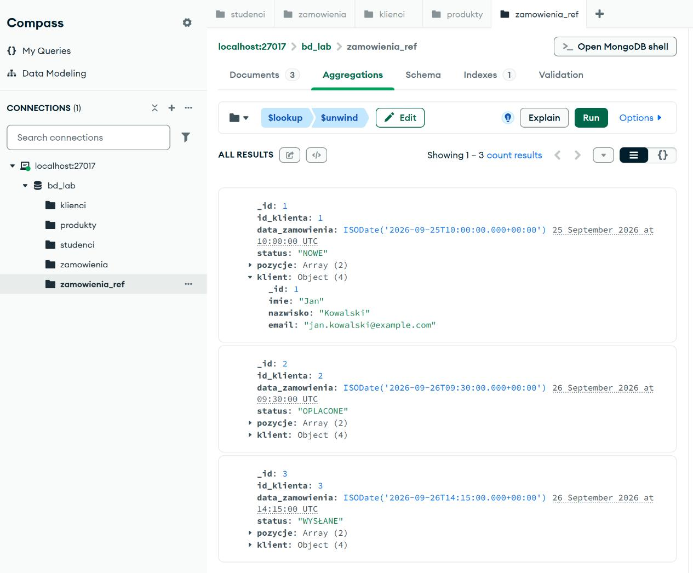
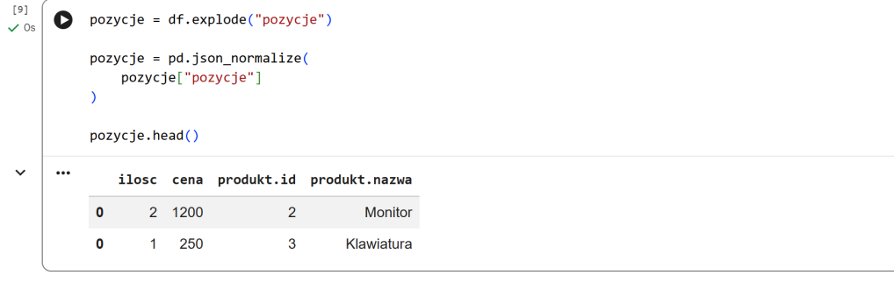
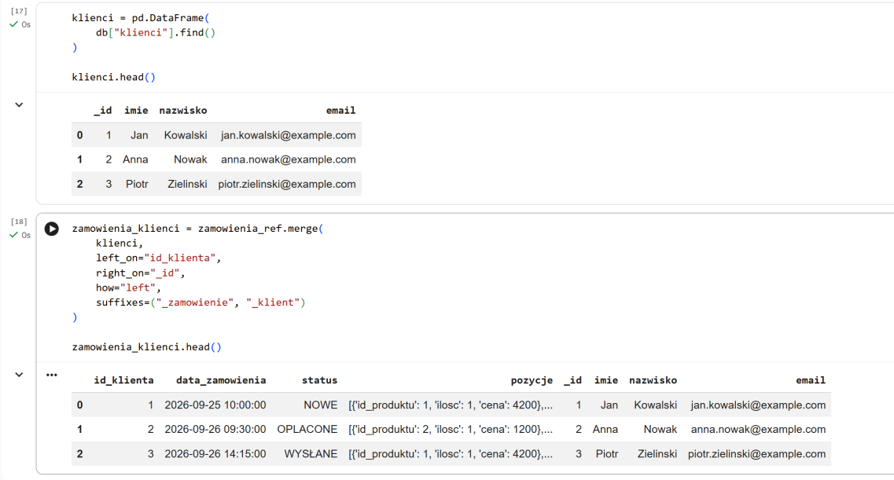
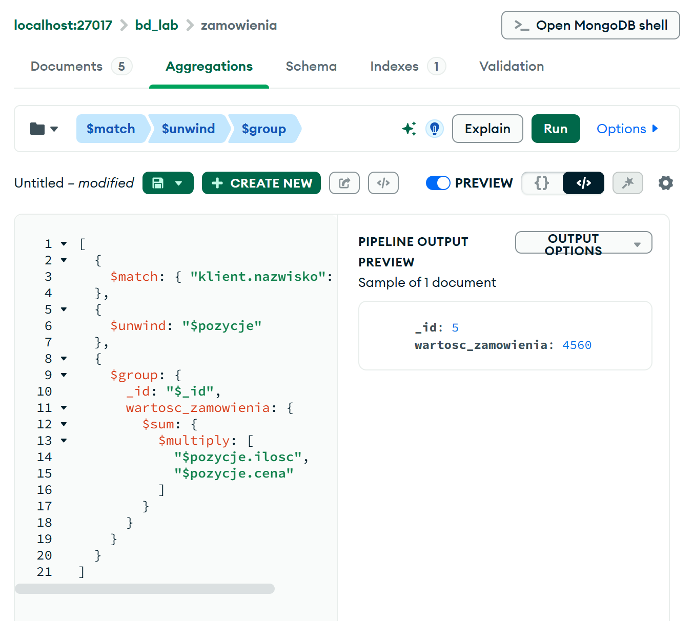

# 02 · MongoDB: embedding vs referencing

The same orders as in the Oracle lab, stored in **MongoDB 8** in two ways and analysed
in mongosh, MongoDB Compass and Python (PyMongo + pandas).

## Scripts

| File | Content |
|---|---|
| `mongosh/01_embedding.js` | orders with embedded `klient` object and `pozycje` array; filters with dot notation, projection, sort, limit, `$set`, `$push`, aggregation (`$unwind`, `$group`, `$sort`) |
| `mongosh/02_referencing.js` | `klienci`, `produkty`, `zamowienia_ref` holding only ids; `$lookup` + `$unwind` |
| `mongosh/03_final_task.js` | my own order: insert, nested filter, projection, sort by date, value = **4560** |
| `python/mongo_to_pandas.py` | embedding → `explode` + `json_normalize`; referencing → three DataFrames + `merge` |

## Results

| | Embedding | Referencing |
|---|---|---|
| Complete order | one document, one read | needs `$lookup` (or `merge` in pandas) |
| Duplication | the Laptop is stored separately in orders 1 and 3 | every customer/product stored once |
| Change of a product name | must update every order | one update |
| Python | 1 DataFrame, nested list must be unpacked | 3 DataFrames that must be joined |

- Order values from the pipeline: **4940** (order 1 after adding a mouse), 4320, **2650**, 1440.
- A real bug: `merge(left_on="id_klienta", right_on="_id")` failed with `KeyError: '_id'`
  because customers had been read with the projection `{"_id": 0}`. In the referencing model,
  joining is the application's responsibility, and it is easy to get wrong.
- Compared with Oracle: no schema, no constraints, no triggers were defined, and documents in one
  collection could have different fields. Data correctness moves from the database to the application.

## Screenshots

**Embedding:** the whole order (customer object + array of lines) is one document; filtering works with dot notation:




Aggregation pipeline (`$unwind` → `$group` → `$sort`) computing order values:



**Referencing:** orders hold only ids; `$lookup` + `$unwind` bring the customer back:




Python: `explode` + `json_normalize` for embedding, `merge` for referencing (after fixing the missing `_id`):




Final task: value of my own order = 4560:



## Run

```powershell
docker run -d --name bd-lab-mongodb -p 27017:27017 mongo:latest
mongosh "mongodb://localhost:27017/bd_lab" mongosh/01_embedding.js
mongosh "mongodb://localhost:27017/bd_lab" mongosh/02_referencing.js
mongosh "mongodb://localhost:27017/bd_lab" mongosh/03_final_task.js
pip install pymongo pandas
python python/mongo_to_pandas.py
```
