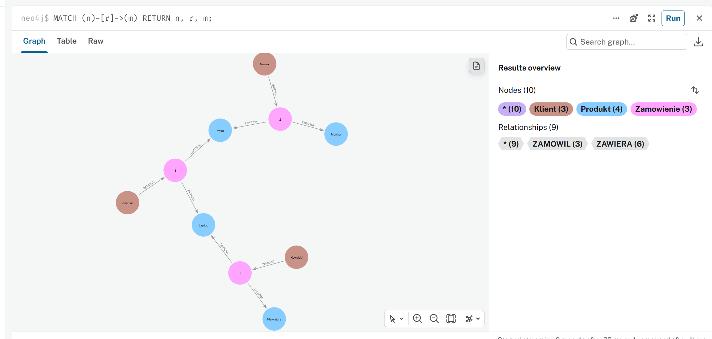
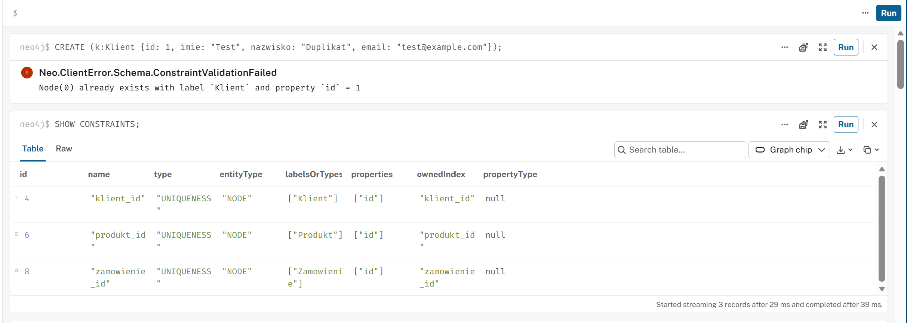
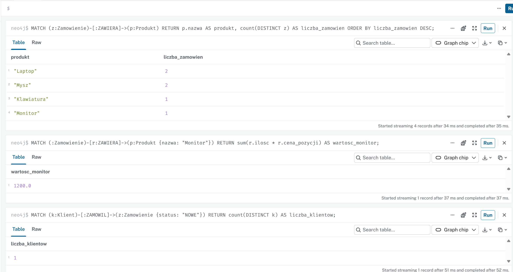
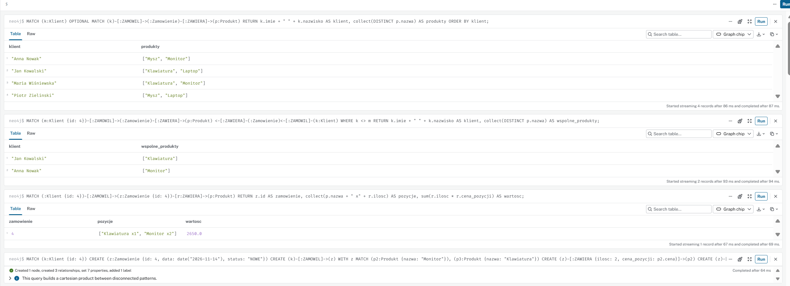
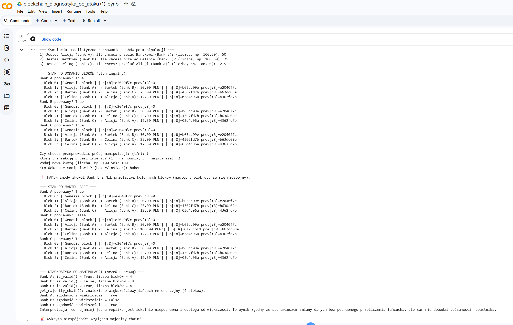
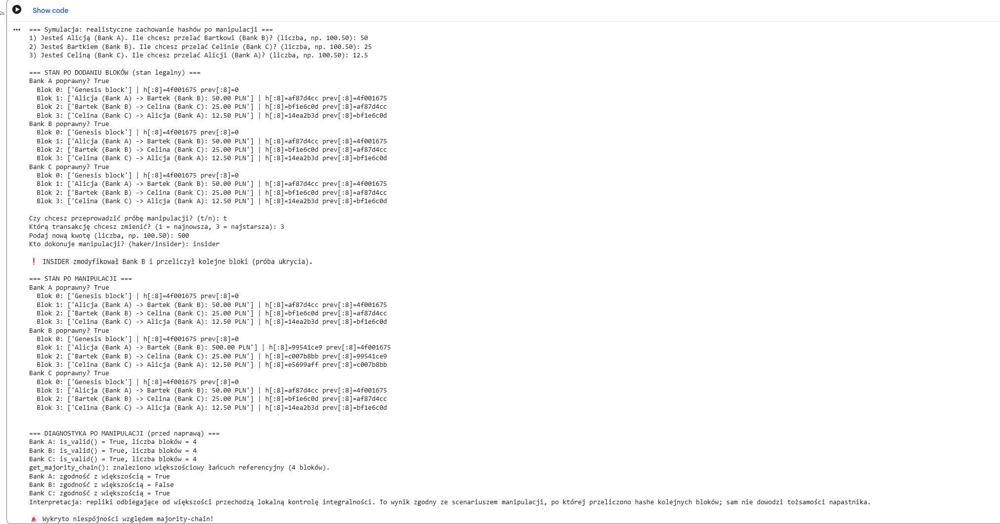

# 03 · Neo4j graph model + educational blockchain

## Part 1: Neo4j

The order problem as a graph in **Neo4j 5.26 Community**:

```
(:Klient)-[:ZAMOWIL]->(:Zamowienie)-[:ZAWIERA {ilosc, cena_pozycji}]->(:Produkt)
```

An order line is neither a table (Oracle) nor an array element (MongoDB). It is a **relationship
with properties**.



### Scripts

| File | Content |
|---|---|
| `neo4j/01_model.cypher` | nodes, relationships, verification (11 nodes, 9 relationships) |
| `neo4j/02_paths_and_queries.cypher` | filters, paths, co-occurrence, `shortestPath`, aggregations, my own queries |
| `neo4j/03_crud_constraints_recommendations.cypher` | `SET`, `DELETE` vs `DETACH DELETE`, uniqueness constraints, index, recommendations |
| `neo4j/04_final_task.cypher` | new order for Maria, its value, customers with common products, `collect` |

### Highlights

**Shortest path between two customers who have no product in common:** Kowalski → order 1 → Laptop ←
order 3 → Mysz ← order 2 ← Nowak (6 hops). One function call in Cypher; SQL would need recursion.

**Constraints:** a duplicate customer id is rejected (`ConstraintValidationFailed`), like a primary key in
Oracle. Every uniqueness constraint also creates a backing index.



**A tie the obvious query would hide:** "Which product appears in most orders?" gives Laptop 2 and Mysz 2.
`LIMIT 1` would return only one of them, so the full ranking is returned instead.



**Final task:** Maria's new order (Monitor × 2, Klawiatura × 1) is worth **2650**, the same value as order
no. 4 in the MongoDB lab. One pattern immediately connects her to Kowalski (Klawiatura) and Nowak (Monitor).



> The graph model fits best data where the **connections between objects** matter most,
> such as recommendations and path finding, because relationships are stored directly instead of
> being rebuilt with JOINs.

### Run

```powershell
docker run -d --name bd-lab-neo4j -p 7474:7474 -p 7687:7687 `
  -e NEO4J_AUTH=neo4j/$env:NEO4J_PASSWORD `
  -v bd-lab-neo4j-data:/data neo4j:5-community
```

Open http://localhost:7474 and run the statements from `neo4j/` one at a time.

---

## Part 2: Blockchain: who can hide a manipulation?

Three banks keep identical copies (replicas) of a chain with three transactions. Every block stores
the SHA-256 hash of the previous block. Then one bank's copy is tampered with:

| | Hacker | Insider |
|---|---|---|
| What they change | block 2: 25 → **100 PLN** | block 1: 50 → **500 PLN** |
| Hashes recomputed | only the changed block | the changed block **and all following** |
| `is_valid()` of the tampered bank | **False**: block 3 still points to the old hash | **True**: chain is internally consistent |
| Detected by | local integrity check **and** majority comparison | **only** comparison with the other replicas |
| Repair | `majority` (sync to the chain held by 2 of 3 banks) | `snapshot` (restore the trusted copy from before the attack) |

Hacker: the broken link is visible in Bank B (block 2 hash changed, block 3 `prev` unchanged):



Insider: all hashes in Bank B recomputed, `is_valid() = True` for every bank, but Bank B disagrees with the majority:



### Conclusions

- The hash makes a "silent" edit inside one chain impossible. Protection against someone who can
  rewrite the whole chain comes only from **distribution** across independent nodes.
- Majority repair works only while honest nodes are the majority. With 2 of 3 banks compromised, the
  "majority" chain would be the forged one (the idea behind a 51% attack).
- Snapshot repair needs a copy stored somewhere trustworthy.
- The simulation has no consensus mechanism or proof-of-work, which in real networks makes rewriting
  the chain expensive.
- Blockchain is one way of organising a distributed ledger (DLT), not a synonym for it.

### Run

```bash
python blockchain/tamper_detection_demo.py
```

`tamper_detection_demo.py` is my own compact, non-interactive re-implementation that reproduces both
lab scenarios. The screenshots come from the interactive notebook used during the lab (not included).
